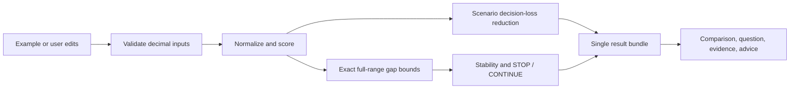

# Worth Asking — Technical Specification

## How This Works, In Plain Language

The app compares two job offers using the importance you give each criterion. Known information contributes a fixed score. Missing information keeps its plausible range; its midpoint supplies the provisional comparison, clearly labeled as an estimate.

Two separate calculations answer two separate questions. A declared set of hypothetical answers estimates how much asking a question could improve the choice. A full-range calculation checks whether any allowed combination of missing values could change the result. Only the full-range calculation can justify DECIDE NOW. The app explains its assumptions; stability within those assumptions is not a probability that a life decision is correct.

Everything runs in the browser. React displays the decision and collects edits; a pure TypeScript engine calculates scores, questions, and advice. No account, database, LLM, credential, or remote API is involved in evaluation. The project is **developed WITH AI using the official Devpost Learn Skill Pack**; the runtime does **not** use generative AI.

## Review and Authorization

WA-02 authorized this specification. Scope and PRD have PO approval and separate architecture PASS records. This complete specification received **architecture PASS**, reviewer **Diana**, dated **2026-10-24**, without blocking changes. **Product Owner approval: granted by Alonso**, explicitly in **WA-03 — BUILD PREPARATION**, dated **2026-10-24** ("DECISION: SPEC APPROVED"). `status: approved` records that separate PO decision. WA-03 authorizes official `5-build` checklist preparation only; its review and PO approval are required before implementation. No application source, package installation, or executable application tests are part of this planning delivery. **No deployment to VESTA.**

The technical choices below have passed architecture review and formal PO approval. The approved two-offer POC boundary remains unchanged. Canonical review format is Markdown; no HTML companion was requested. See `../docs/WA-02-review-record.md` and `../docs/WA-03-review-record.md` for separate approvals, nonblocking observations, and the build-checklist checkpoint.

## The Core Journey Through the System

Implements `prd.md > The Core Journey` and `Features and Behavior > Update Your Evidence and Compare`.

1. Load example → copy fixture input into the session → validate → evaluate it.
2. Evaluation → fixed-anchor utility normalization → weighted provisional scores and exact full-range gap bounds → deterministic hypothetical-answer calculation → ranked questions and stability advice.
3. Render one immutable result bundle so the offer comparison, next question, readiness, and advice describe the same valid inputs.
4. Edit importance/ranges or enter evidence → retain raw form strings for validation → atomically apply a valid transaction → preserve the immediately preceding valid result → recompute the whole bundle.
5. Invalid edit → inline error and unevaluated state; any previous result is explicitly labeled "Previous valid evaluation." No current verdict is presented for invalid data.
6. Reload example resets the session and before/after comparison. Browser reload closes the session; there is no persistence promise.



## Stack

| Piece | Choice and reason | Official reference |
| --- | --- | --- |
| Runtime | Node 24.x for local tooling; observed machine v24.21.0, npm 11.19.0. Browser evaluation uses native BigInt. | [Node](https://nodejs.org/en/download), [BigInt](https://developer.mozilla.org/en-US/docs/Web/JavaScript/Reference/Global_Objects/BigInt) |
| UI | PO-selected React + TypeScript; typed inputs/results and a single decision workspace. | [React](https://react.dev/learn), [TypeScript](https://www.typescriptlang.org/docs/) |
| Tooling | PO-selected Vite with the React TypeScript plugin/template; static distribution and local dev server. | [Vite](https://vite.dev/guide/), [plugins](https://vite.dev/plugins/) |
| Unit checks | Vitest for engine contracts and deterministic cases; TypeScript type checking separately. | [Vitest](https://vitest.dev/guide/) |
| Browser checks | Playwright Test for the same demo on desktop/mobile, validation, and keyboard flow. | [Playwright](https://playwright.dev/docs/intro) |
| Styling | Plain CSS variables/grid; local system fonts, no UI framework or remote font dependency. | [CSS](https://developer.mozilla.org/en-US/docs/Web/CSS) |

Documentation was consulted during drafting. Current Vite documentation lists Node 20.19+/22.12+; current Vitest documentation lists Node >=22.12 and Vite >=6.4. Node 24 is the proposed common baseline. No project packages have been installed or compatibility-tested. At the first approved build slice, select compatible stable releases, save exact direct dependency versions, commit `package-lock.json`, and record actual versions in README. Do not assert latest patch numbers or silently upgrade the agreed stack. Judge setup uses `npm ci`, not floating `npx ...@latest`.

## Where It Runs and How Someone Tries It

The following are **future required commands**, not working commands at the current documentation-only checkpoint. Run them inside the completed `worth-asking` repository after implementation:

```powershell
npm ci
npm run dev -- --host 127.0.0.1 --port 5173 --strictPort
```

Open `http://127.0.0.1:5173`, choose "Load example decision," inspect the office-attendance question, enter A = 5 and B = 1 days/week, and apply evidence. No `.env` or credentials are required. Install initially requires network access to obtain development dependencies; once installed, evaluation and the demo require no external network service.

Required package-script contracts: `dev` = `vite`; `typecheck` = `tsc --noEmit` against the app/config TypeScript project(s); `test` = `vitest run`; `build` = typecheck then `vite build`; `preview` = `vite preview`; `test:e2e` = `playwright test`. Configure the projects so the selected typecheck command actually covers source and configuration. Browser-test setup uses `npx playwright install chromium` after approved dependency installation, then `npm run test:e2e`. Preview: `npm run preview -- --host 127.0.0.1 --port 4173 --strictPort`, open `http://127.0.0.1:4173`.

Record the required short demo video only after working-app validation. The official curriculum also requires a public GitHub repository; publication belongs to shipping with a secrets/history check. Deployment is optional; no VESTA deployment without explicit GO.

## Look and Feel
WA-UX-01 presentation update: main copy 17–18px, explanations 15–16px, technical labels at least 14px, controls 16–18px, and main headings 28–32px. OfferCard renders current fixture inputs only, in a semantic table inside an independently focusable, vertically scrollable region. Initial desktop region height is 30.25rem, with 18–48rem vertical resize bounds and unchanged column widths. Below 900px, stack cards, disable resizing, and retain native scrolling; narrow-screen default is 32rem. Score and explanation remain outside the region and use the current engine result, with no current score on invalid input. Verify 320px and 390px widths. Mathematical model and office domain remain 0–5.


Implements `prd.md > Look and Feel` and `Screens and Layout`, updated by WA-02.

Use the PO-selected team artwork's described visual language: deep navy, cyan, violet, subtle gold accents, and restrained luminous treatment. Its actual image has not been attached or inspected; do not invent its composition. The artwork is a promotional reference, not a required layout or a prerequisite to engine design.

Proposed CSS tokens for review: background `#081120`, raised surface `#111D33`, main text `#F2F6FF`, secondary text `#BAC8DF`, cyan `#69E3F5`, violet `#BBA8FF`, gold `#E6C677`. Use dark text on filled light accent controls. Verify actual pairwise contrast in the build, rather than assuming a palette guarantees accessibility. Text contrast target: 4.5:1 for normal text, 3:1 for large text; interactive boundaries/focus target 3:1. Reference: [WCAG 2.2](https://www.w3.org/WAI/WCAG22/quickref/).

System font stack: `Inter, "Segoe UI", system-ui, sans-serif` without fetching Inter; calm medium-weight headings, tabular numerals for scores. One spacious workspace, maximum content width 1160px, 16–32px page gutters, side-by-side offers at >=900px and a single-column flow below. At 360px, no page-level horizontal scroll. Avoid fixed heights and tiny numerical fields. Gold is a small emphasis detail, never a confidence code. Cyan/violet distinguish interaction and offer identity; use text/icons alongside color. Keep the question or final advice visually prominent; methodology expands inline using accessible disclosure, not another dashboard.

English only. Tagline: **"Know what to ask. Know when to stop."** Native labeled controls, visible keyboard focus, error links/descriptions, an `aria-live="polite"` update summary, >=44px primary touch targets, reduced-motion support, and no glow behind body text. Do not claim WCAG certification from these design targets.

## Components

### Decision Types and Validation

Files: `src/engine/types.ts`, `validation.ts`. Implements `prd.md > Features and Behavior > Your Decision and Evidence` (DE-01–04) and `States and Boundaries`.

Validate an entire candidate decision before evaluation. Return a discriminated success/error result with path-specific error codes/messages; no partially valid numeric result. Treat arbitrary typed/cast runtime objects as untrusted inputs. Require exactly two offers and a complete two-cell row for each criterion. Prevent unsupported model assumptions from silently changing the feasible set.

### Exact Arithmetic and Normalization

Files: `src/engine/rational.ts`, `utility.ts`, `format.ts`. Implements DE-03, DR-02–04, and SL-05. Parse decimals directly into reduced signed BigInt fractions; normalize against fixed anchors; use exact fractions throughout decisions. Formatting converts only at the presentation boundary. Detailed rules follow below.

### Robust Score-Gap Bounds

File: `src/engine/bounds.ts`. Implements `prd.md > Features and Behavior > Stopping Logic` and `Decision Readiness`.

Use separable affine interval arithmetic over the complete independent uncertainty box. Compute per-criterion gap intervals and exact attainable extrema. This module does not consume hypothetical-scenario frequencies or call the question-priority module. Return endpoint witnesses explaining how extrema are attained.

### Question Prioritization

Files: `src/engine/scenarios.ts`, `questions.ts`. Implements `prd.md > Features and Behavior > Question Value and Priority`.

Group unresolved cells by criterion into one natural-language question. Enumerate the complete endpoint scenario set for the declared hypothetical-answer model; calculate exact before/after expected decision loss and deterministic ranks. Keep robust relevance separate from scenario VOI, disclose ties and scenario-model limitations, and never infer STOP from zero estimated VOI.

### Recommendation Policy and Evaluation

Files: `src/engine/policy.ts`, `evaluate.ts`. Implements SL-01–05, DR-01–04, QV-04, and UP-02–03.

Pure evaluation order: validation → weights/utilities → provisional result → full-range bounds → stability/policy → questions → immutable result bundle. Recommendation policy reads only validated full-range analysis. No fixture names, IDs, preselected office question, previous result, or expected-output table may influence model calculations. Unknown-question templates use criterion labels and units; their rank comes from the engine.

### Decision Workspace and Session

Files: `src/state/session.ts`, `src/App.tsx`, `src/components/*`. Implements `prd.md > The Core Journey`, `Screens and Layout`, `Update Your Evidence and Compare`, and `States and Boundaries`.

Use a reducer for empty/valid/invalid-edit states, raw form buffers, committed decision, current result, and one previous valid result. Keep no duplicate mutable score fields. Changes apply as atomic transactions; partial evidence resolves only supplied cells. An out-of-assumed-range answer requires explicit range correction before applying, with a warning that earlier advice depended on the prior range. Do not silently broaden or clamp. Example reload clears previous comparison; no history or cross-session save.

Components: DecisionInputs (criteria, weights, evidence/ranges); OfferComparison (contributions and totals); Readiness (categorical state and gap range); QuestionCard (question, VOI, rationale/tie); EvidenceForm (partial/both answers); Recommendation (conditional advice); MethodDetails (assumptions and reproducible calculation explanation); UpdateSummary (immediately prior/current comparison). These are parts of one page, not new product screens.

### Demonstration Data and Verification

Planned files: `src/data/jobOffers.ts`, `src/engine/__tests__/*`, `tests/e2e/decision.spec.ts`. Implements `prd.md > Acceptance and Demonstration`.

Fixture data contains inputs only. Golden expected outcomes live in test assertions, never the production evaluator. A temporary exact-arithmetic worksheet checked the design numbers in this document; it is not an implementation or a passing application test. See `../docs/WA-02-fixture-check.md`.

## Data Model

### Decision Input

All numeric source values are canonical decimal strings; no raw JS floating-point inputs enter the engine.

| Entity | Required fields and contract |
| --- | --- |
| Decision | Stable ID, label, exactly two offer IDs/labels, criteria, `uncertaintyModel: independent-box`, model version. |
| Criterion | Unique ASCII ID, label, unit, direction (`higher` or `lower`), fixed domain/normalization anchors `a < b`, importance `p`, generic question wording, one cell per offer. |
| Known cell | `kind: known`, decimal `value`, `source: user-evidence` or `example-evidence`; evidence note optional and rendered as text. |
| Unknown cell | `kind: unknown`, decimal `lower`, `upper`, `source: assumption`; provisional midpoint is derived and labeled estimate, never stored as a known value. |
| Evidence transaction | Criterion ID and one or both offer IDs with entered values; omitted answers preserve their cells. Do not submit an all-empty transaction. |

Proposed operating bound: 2–6 existing criteria, at most 12 nondegenerate unknown cells. This is a finite validation bound on engine input, not a new UI feature to add/remove criteria. No generic criterion-builder or correlation editor. Current example has four criteria. IDs sort by ASCII code-point order, not locale. Criterion domain endpoints are also fixed normalization anchors; altering an assumption range does not renormalize those anchors.

Allowed unresolved values comprise the full real interval between the entered endpoints. Input entry is limited to two decimal places, but the underlying uncertain quantity is not quantized to that entry step. Office attendance means average mandatory days/week, so fractional averages are permitted; growth is a subjective 0–10 utility rating. No discrete-only, correlated, coupled, nonlinear, or conditional feasible-set constraints are supported. Their input is rejected as unsupported rather than approximated silently. Independence of ranges is a conservative modeling assumption disclosed beside all advice, not an empirical assertion about employers.

### Evaluation Result

Success contains: model version; canonical input fingerprint (canonical string, no cryptographic/security claim); rational normalized weights; per-cell normalized known/estimated utilities; per-criterion contributions; provisional totals and gap; provisional preference (`A`, `B`, `tie`); per-criterion gap bounds; total attainable bounds and endpoint witnesses; stability; recommendation; ranked question records; explanatory facts/assumptions. A question record contains target cells, robust-relevance flag, baseline loss, post-answer loss, VOI, tie group, and exact conditional outcome groups for MethodDetails.

Failure contains no current scores or verdict: error code/path/message list. Rational result values remain in memory; diagnostic/expected representations use reduced `numerator/denominator` strings rather than JSON-serializing BigInt. Raw text, evidence, decision, and results stay in browser memory only. Refresh/tab close clears them. No telemetry or runtime outbound data transmission.

## Decision Engine Mathematics

### Normalization and Importance

Implements DE-01–03. For criterion j, fixed anchors are a_j < b_j. All known values and unknown range endpoints must lie in [a_j,b_j].

- Higher is better: u_j(x) = (x − a_j)/(b_j − a_j).
- Lower is better: u_j(x) = (b_j − x)/(b_j − a_j).
- Importance p_j >= 0, total P = sum_j p_j > 0; normalized w_j = p_j/P.
- Normalized utility lies in [0,1]; no clipping, relative-to-offer normalization, or nonlinear transformation.
- Display score for offer k: S_k(x) = 100 × sum_j w_j u_j(x_kj), in **utility points**, not percent confidence.

Zero weight contributes exactly zero. Known x uses its supplied value; unknown x uses midpoint (lower+upper)/2 only for the provisional score. For a degenerate unknown lower=upper, use that exact value without creating a question; keep its assumption provenance until evidence is entered. Thus numerical certainty is distinct from a verified fact. The additive linear model expresses elicited preferences; it does not establish objective job quality or interactions between criteria.

### Complete Plausible Bounds and Combined Uncertainty

Implements SL-01–05 and DR-01–04. A known cell has normalized interval [u,u]; an unknown has interval [min(u(lower),u(upper)), max(u(lower),u(upper))]. Call these [v_kj^-,v_kj^+]. Define per-criterion gap interval:

- d_j^- = 100 w_j (v_Aj^- − v_Bj^+).
- d_j^+ = 100 w_j (v_Aj^+ − v_Bj^-).
- L = sum_j d_j^-; H = sum_j d_j^+.
- D(x) = S_A(x) − S_B(x); its full attainable set is [L,H].

Proof: each term is affine and monotone in its own independent cell; selecting its minimizing/maximizing raw endpoint attains that term's bound. The box allows all those endpoint choices simultaneously, so the sum bounds are attainable, not merely conservative enclosures. Since the box is connected and D is affine, every gap between extrema is attainable. Preserve the chosen raw endpoint vector as a witness for each bound. This proof fails for coupled constraints or nonlinear normalization; those models are outside the supported input contract.

No one-at-a-time sensitivity substitute and no limited sampling may certify STOP. Summing all uncertain contributions covers combined unknowns even when each individual change around the midpoint cannot reverse the preference. Bounds cost O(number of criteria); question enumeration does not affect them.

### Stability and STOP / CONTINUE

Implements SL-01–05 and DR-01–04. Comparisons below use exact fractions, with no epsilon:

| Condition | Stability | Investigation | Visible result |
| --- | --- | --- | --- |
| L > 0 | Stable preference: A | STOP | DECIDE NOW; A remains preferred throughout allowed ranges. |
| H < 0 | Stable preference: B | STOP | DECIDE NOW; B remains preferred throughout allowed ranges. |
| L = H = 0 | Indistinguishable | STOP, inconclusive | Model cannot distinguish offers; no modeled question can break the tie. No recommended winner. |
| Otherwise (L <= 0 <= H, not both zero) | Unsettled | CONTINUE | KEEP INVESTIGATING; explain reversal or a tie boundary. |
| Invalid input or failed analysis | Cannot evaluate | No verdict | Correct inputs/analysis; never default to STOP or a winner. |

Provisional preference independently compares midpoint gap D0 against zero. It can be a tie even when unresolved evidence could favor either offer. An interval touching zero fails the strict unique-preference test. Fully known decisions have L=H=D0: either a strict unique STOP or an honest tie. The user-facing DECIDE NOW subheading is "You know enough to make a decision." Append "Under your current criteria, importance, evidence, and independent plausible ranges." Never imply certainty about facts outside the model. No confidence/readiness percentage is calculated.

### Hypothetical Scenario Construction

Implements QV-01–04. This is an explicit discrete **model for question ranking**, distinct from the full allowed continuous uncertainty set.

1. Take each nondegenerate unknown cell in ASCII `(criterionId, offerId)` order. Its hypothetical answers are its two raw endpoints, each assigned modeling weight 1/2.
2. All known/degenerate cells stay fixed. Enumerate the Cartesian product of endpoint choices in ascending endpoint order. For m unknown cells there are N=2^m equally weighted worlds, with weight 1/N (N=1 if m=0). The operating bound is N<=4096. Do not randomly sample or truncate enumeration.
3. These weights express a symmetric endpoint thought experiment. They are not observations, employer likelihoods, confidence levels, or a claim that interior values are impossible. The allowed range for real evidence still includes all interior values.
4. Because utility is affine and endpoint weights are symmetric/independent, each scenario mean equals the provisional midpoint utility. This keeps the initial decision and baseline-loss calculation aligned.
5. Rebuild the model after each evidence/range/importance update. Actual evidence may be an interior value absent from prior endpoint scenarios; fix that value and enumerate remaining unknown endpoints anew.

### Decision Loss and Value of a Question

Let U_k(s) be S_k in hypothetical world s, pi_s=1/N, and E_s denote the weighted sum over these worlds. For choosing offer k, regret (decision loss) is r(k,s)=max(U_A(s),U_B(s))−U_k(s), in utility points.

Baseline action k0 maximizes E_s[U_k(s)]. For an exact tie, choose the first ASCII offer ID only as a computational loss convention; the UI still says tie. Baseline loss R0 = E_s[r(k0,s)].

One question q resolves all currently unknown, nondegenerate cells belonging to one criterion (one or both offers). It does not resolve other criteria. Partition worlds into groups t with the same revealed tuple for q. Each group has mass pi_t = count(t)/N. Conditional weights within the group are 1/count(t). Choose k_t maximizing the conditional mean utility, applying the same internal tie convention. Compute:

- Rq = sum_t pi_t × E_s[r(k_t,s) | t].
- VOI(q) = R0 − Rq.
- Equivalent check: VOI(q) = sum_t pi_t × max_k E_s[U_k | t] − max_k E_s[U_k].

Both expressions must agree exactly; VOI must be >=0. Negative VOI or disagreement signals an engine invariant failure, not a value to silently clamp. All other uncertainties remain in each conditional mean, so this is the value of this single answer, not an assumption of resolving everything. It is not multiplied by scenario win frequency and is not a research-time metric. No research-cost editor/threshold is added.

### Relevance, Ranking, and Ties

For each question criterion q, let its gap contribution range be [l_q,h_q]=[d_q^-,d_q^+]. The remaining criteria range is [r^-,r^+]=[L−l_q,H−h_q]. A question is robustly decision-relevant exactly when:

1. It has at least one unknown nondegenerate target and h_q > l_q; and
2. The intersection [r^-,r^+] ∩ [−h_q,−l_q] is nonempty.

This means some allowed setting of the other unknowns places the choice at a point where answering q can reverse it or create/break a tie. The full continuous independent-box contract makes that intersection test attainable. Zero-weight, degenerate, or purely known criteria fail condition 1. In a strictly robust STOP, no criterion passes condition 2.

Prioritize relevant questions by exact VOI descending. Group questions with equal rational VOI into the same displayed value rank. Within each tied group, use ASCII criterion ID ascending solely for deterministic presentation; explicitly say "Tied modeled information value." Do not use that ID to claim one tied question is uniquely best. Nonrelevant unresolved facts may remain in the input comparison but are not promoted as questions worth investigating.

If CONTINUE and every relevant question has VOI=0, show the tied questions with: "This scenario model cannot distinguish a best single question. Remaining uncertainties can still change the choice together." Present the first only as a reproducible next step, with tied alternatives visible in the same disclosure; never say no more evidence is useful. This handles complementary unknowns where neither answer alone changes conditional mean choice. If policy says STOP, suppress the investigate call to action even if unknown facts remain. The relevance test is analytical, so scenario-zero VOI can never erase a robustly consequential uncertainty.

### Numerical Precision, Equality, and Display

Use reduced fractions `{numerator: bigint, denominator: bigint}` with positive denominator and GCD reduction after arithmetic. Decimal parsing is exact base-10; e.g. `0.10` becomes 1/10 without passing through `parseFloat`. Arithmetic is +, −, ×, ÷, cross-multiplied comparisons, and min/max; no random seeds or floating-point evaluation.

- Numeric input contract: trim whitespace, optional leading minus, digits with optional decimal point and 1–2 fractional digits (integers allowed), absolute magnitude <=1,000,000,000. Reject exponents, commas, currency symbols, empty/partial strings, NaN, Infinity, >2 decimals, and overlong strings (>32 characters). Canonicalize leading/trailing zero variants and negative zero. Domain and weight validation apply afterward.
- Importance range: 0–100, at most two decimals, total strictly positive. Criterion anchors finite, distinct, ordered. No division by zero.
- All signs, ties, bounds, VOI ties, and invariants compare exact fractions; **epsilon=0**. No floating-point tolerance may turn a tie-touching interval into STOP or create an Indistinguishable verdict.
- Primary scores and VOI display to two decimals with exact decimal half-away-from-zero rounding. Provisional gap displays separately; do not subtract rounded scores to derive it.
- Bounds display rounded outward to two decimals (lower=floor(100L)/100, upper=ceil(100H)/100), labeled outward-rounded. Decisions always use unrounded fractions. If a nonzero number displays as 0.00 or both scores appear tied despite an exact nonzero gap, add a "below display precision" sign note and expose its exact fraction in MethodDetails. Never label a value exact zero unless it is exactly zero.
- MethodDetails exposes exact fractions for totals, bounds, R0/Rq/VOI and the assumptions needed to reproduce them; native BigInt is never serialized by raw `JSON.stringify`.

This small exact-arithmetic module adds implementation work but avoids a hidden epsilon policy around the core STOP boundary. Tests must independently verify its arithmetic and formatting; if implementation cannot meet these rules, return the specification for revision rather than quietly switching semantics.

### Validation and Error States

Reject structural errors (wrong offer count, missing cells, duplicate/invalid IDs, 0/1/>6 criteria, absent labels/unit/direction, malformed cell union), unsupported uncertainty model, numeric contract failures, out-of-domain values/endpoints, lower>upper, invalid anchors, importance outside range, and zero-total importance. Validate even zero-weight criterion data; do not silently drop invalid rows. Missing unknown bounds are incomplete input, not an infinite range or zero.

Suggested stable codes: `INCOMPLETE_INPUT`, `INVALID_NUMBER`, `OUT_OF_DOMAIN`, `INVALID_RANGE`, `INVALID_WEIGHT`, `ZERO_TOTAL_WEIGHT`, `INVALID_STRUCTURE`, `UNSUPPORTED_MODEL`, `OUTSIDE_ASSUMED_RANGE`, `ANALYSIS_FAILURE`. Unknown object fields may be ignored only when they have no mathematical meaning; reject declared correlation/constraints instead of ignoring them. Render notes as text, never HTML.

An answer within domain but outside an assumed range produces OUTSIDE_ASSUMED_RANGE; keep it as uncommitted text, explain the mismatch, and allow the user to edit the existing bounds explicitly. A corrected range then allows the evidence transaction. Invalid state withholds the current verdict; prior results remain labeled as previous. On an unexpected invariant/analysis failure, show Cannot evaluate and a retry/reload action; never fall back to fixture outcomes or an invented question.

## Deterministic Demonstration Fixture

Implements `prd.md > Acceptance and Demonstration`. Offer A: **Northstar — Product Analyst**. Offer B: **Harbor — Product Analyst**. Fictional comparable full-time offers, annual USD gross salary, same currency/period. No tax/currency prediction. Growth is the user's subjective 0–10 career-fit scale; known/unknown values below are illustrative data, not employer claims.

| Criterion / ID | Direction; fixed anchors | Importance | Offer A | Offer B |
| --- | --- | --- | --- | --- |
| Annual salary / salary | Higher; USD 80,000–120,000 | 40 | Known 110,000 | Known 100,000 |
| Mandatory office attendance / office | Lower; average days/week 0–5 | 40 | Unknown [0,5] | Unknown [0,5] |
| Career growth fit / growth | Higher; rating 0–10 | 15 | Unknown [6,8] | Known 7 |
| Annual paid leave / leave | Higher; days 10–30 | 5 | Known 20 | Unknown [18,22] |

Questions are criterion-based: office asks mandatory average days/week for each offer; growth asks the missing career-fit rating; leave asks Harbor's paid-leave entitlement. Wording is data, priority is computed.

### Initial Calculation

Importance total=100. Midpoint estimates: office A=2.5, office B=2.5, growth A=7, leave B=20.

| Utility-point contribution | A | B | Gap A−B | Full gap range |
| --- | ---: | ---: | ---: | --- |
| Salary | 30 | 20 | 10 | [10,10] |
| Office | 20 | 20 | 0 | [−40,40] |
| Growth | 10.5 | 10.5 | 0 | [−1.5,1.5] |
| Leave | 2.5 | 2.5 | 0 | [−0.5,0.5] |
| Total | **63** | **53** | **10** | **[−32,52]** |

A is provisionally preferred, but the full gap permits reversal: Unsettled / CONTINUE. There are four nondegenerate unknown cells → 16 equally weighted endpoint thought-experiment worlds.

### Consequential Question Calculation

Conditional on resolving office alone, the four endpoint answer groups have midpoint gaps +10 (A0/B0), +50 (A0/B5), −30 (A5/B0), +10 (A5/B5). Each group has mass 1/4 and retains four growth/leave worlds. Growth/leave together can shift gap by at most 2, so each office group's optimal offer is unique throughout its residual range.

Choosing provisional A has loss only in A5/B0 worlds: average regret 30, group mass 1/4 → R0=30/4=**7.5 utility points**. After office information, R_office=0 → VOI_office=**7.5**. Resolving growth alone or leave alone leaves positive conditional mean gaps, so neither changes the baseline action: VOI_growth=VOI_leave=**0**. Both can still be robustly relevant in some allowed interior office configurations; describe their zero scenario value honestly. Office is the unique highest-value question for these inputs.

### Evidence and Reversal

User evidence: A requires **5** average office days/week; B requires **1**. These answers are inside both assumed [0,5] ranges, though B=1 is not a prior hypothetical endpoint. Resolve both cells and recompute; do not use a scenario lookup table.

| Utility-point contribution after evidence | A | B |
| --- | ---: | ---: |
| Salary | 30 | 20 |
| Office | 0 | 32 |
| Growth (still estimated where unknown) | 10.5 | 10.5 |
| Leave (still estimated where unknown) | 2.5 | 2.5 |
| Total | **43** | **65** |

New provisional gap=**−22**. Remaining unknown contributions are growth [−1.5,1.5] and leave [−0.5,0.5], so the complete gap range is **[−24,−20]**. H<0 strictly: B is preferred throughout the remaining uncertainty box → Stable preference / STOP / **DECIDE NOW**. Unknowns still exist, but cannot change this ranking under the current model. The initially preferred offer A genuinely reverses to B by calculation. No result is part of production fixture input.

## Acceptance Tests and Verification Plan

These are **future executable acceptance tests** to implement after approvals; the worksheet has checked only design arithmetic. Do not report them as passing application tests.

| ID / planned home | Case and required assertions | PRD trace |
| --- | --- | --- |
| AT-01 `fixture.test.ts` | Initial 63/53, gap10, bounds [−32,52], CONTINUE; office VOI=15/2 versus growth/leave=0; evidence A5/B1 yields43/65, gap−22, bounds[−24,−20], B/STOP. Confirm fixture has only inputs. | QV-01–04, SL-01–04, UP-01–03 |
| AT-02 `bounds.test.ts` | Combined uncertainty construction below: one-at-a-time checks retain A, combined lower bound is negative; policy must CONTINUE. Compare analytic bounds with independently computed vertex extrema on bounded small cases. | SL-02, QV-03 |
| AT-03 `policy.test.ts` | Strict positive/negative intervals yield respective STOP; [0,1], [−1,0], [−1,1] CONTINUE. Full-known and all-zero-weighted-difference [0,0] yield STOP inconclusive with no winner. A midpoint tie with range[−1,1] remains Unsettled. | SL-01–05, DR-01 |
| AT-04 `questions.test.ts` | Combined case has both individual VOIs zero despite robust CONTINUE: show disclosed tied next steps, never false STOP. Exact equal positive VOIs share rank and use ASCII ID presentation ordering. Reordering input arrays does not change results. | QV-03–04, DR-04 |
| AT-05 `utility.test.ts` | Verify anchors/directions, fixed normalization after range changes, weighted additive contributions, midpoint estimates, and invariance to proportional scaling of valid importance weights. Zero-weight wide unknown contributes0 and is not relevant; invalid zero-weight data still fails validation. | DE-01–04, QV-02 |
| AT-06 `validation.test.ts` | Parameterized malformed/missing values, blanks/NaN/Infinity/exponents/too many decimals, incomplete cells/bounds, duplicate IDs, invalid offers, reversed/domain-exceeding ranges, zero-total/negative importance, unsupported coupled model, invalid operating size, and out-of-assumed-range evidence. Assert codes and no current verdict. | DE-04, SL-05 |
| AT-07 `evidence.test.ts` | A-only evidence leaves B unknown; full evidence resolves only office; prior result preserved; edits update all outputs atomically; invalid edits do not masquerade as current advice; interior answers trigger fresh evaluation. | UP-01–03 |
| AT-08 `rational.test.ts`, `format.test.ts` | Exact decimal parsing; rational arithmetic/order; exact 0.1+0.2=0.3; tiny positive/negative gaps remain signed; zero-touching bounds never become strict STOP; outward bound rounding and below-display-precision notes; no BigInt JSON crash. | SL-05, DR-02–04 |
| AT-09 `reproducibility.test.ts` | Repeat/canonicalize identical inputs, permute row order, and rerun: exact fractions, bounds, tie groups, and recommendation match. Verify VOI loss-reduction identity and nonnegativity using independent small enumerations. | QV-04, DR-04 |
| AT-10 `decision.spec.ts` | Desktop1440×900 and mobile390×844 plus360px width: load, office question, evidence, reversal, DECIDE NOW, remaining unknown labels, before/after summary. No page horizontal overflow, overlapping/hidden controls, or clipped advice. Capture screenshots and visually inspect. | Core Journey, Screens and Layout |
| AT-11 `decision.spec.ts` + manual review | Keyboard-only completion, labels/focus/aria-live, invalid-edit correction, no color-only verdict, contrast check, 200% zoom/reflow, reduced motion. Verify no runtime remote API requests or key/login requirement. | Look and Feel, States and Boundaries |

AT-02/04 exact construction: three criteria with importance40/30/30. Known criterion anchors[0,100], A57.5/B50 → fixed gap3. Each of two uncertain higher-better criteria has anchors[0,30], A unknown[0,4], B known2 → contributions x,y independently in[−2,2]. D=3+x+y; initial gap3, each one-at-a-time minimum1, joint bounds[−1,7]. Both one-question conditional mean gaps are1 or5, so both VOIs=0, yet joint uncertainty can reverse. After first answer x=−2, bounds[−1,3] still CONTINUE; after y=−2, fixed gap−1 → B/STOP. These are separate verification data, not additional user workflows.

Mechanical completion checks after implementation: `npm run typecheck`, `npm test`, `npm run build`, browser suite, and targeted desktop/mobile visual review. Re-run checks after changes that affect them; report actual results and limitations. No blanket full-suite repetition after unchanged documentation is required.

### Calculation Performance Measurement

Diana's nonblocking architecture observation requires measurement during implementation, including the maximum supported scenario count. Benchmark the real production evaluator on the four-unknown demo (16 endpoint worlds) and a valid six-criterion decision with all 12 cells nondegenerately unknown (**4096 worlds**). Record device/CPU, browser and build version, input fixture, and scenario count. In the browser production build, use `performance.now()` around full evaluation, with 5 warm-up calls and 30 measured calls; report median, nearest-rank p95, and maximum elapsed milliseconds. Separately time full-range bounds and question enumeration/prioritization so the cost of each is visible. Check UI responsiveness after evidence/importance edits on desktop and mobile, noting actual hardware or emulation. Preserve the measured report in `docs/performance.md` during the build; no performance values or passing threshold are claimed now. Any change to supported size or algorithm prompted by measurement requires review; never replace the independent full-range calculation with sampled STOP logic.

## File Structure

Annotated **planned** application files; only planning documents currently exist. This tree does not claim implementation completion.

```text
worth-asking/
  .agents/skills/                 # installed official six-stage Skill Pack
  skills-lock.json               # installed skill provenance
  .gitignore                     # excludes profile, credentials, generated output
  LICENSE                        # MIT
  README.md                      # verified install/run/demo and AI-development disclosure
  index.html                     # Vite entry (planned)
  package.json                   # exact dependencies and script contracts (planned)
  package-lock.json              # reproducible npm install (planned)
  tsconfig.json                  # strict app/config coverage (planned)
  vite.config.ts                 # React plugin and unit-test setup (planned)
  playwright.config.ts           # desktop/mobile Chromium projects (planned)
  src/
    main.tsx                     # mount UI
    App.tsx                      # one workspace
    styles.css                   # tokens, responsive layout, focus/reduced motion
    data/jobOffers.ts            # fixture inputs only
    state/session.ts             # atomic edits and immediately previous result
    components/
      DecisionInputs.tsx
      OfferComparison.tsx
      Readiness.tsx
      QuestionCard.tsx
      EvidenceForm.tsx
      Recommendation.tsx
      MethodDetails.tsx
      UpdateSummary.tsx
    engine/
      types.ts                   # validated input and result contracts
      validation.ts              # strict parsing/domain/structure guards
      evidence.ts                # pure partial-evidence validation and transaction
      rational.ts                # exact BigInt fractions
      format.ts                  # exact decimal and outward-bound formatting
      utility.ts                 # normalization, weights, provisional scoring
      bounds.ts                  # full-box exact bounds and witnesses
      scenarios.ts               # complete endpoint thought-experiment worlds
      questions.ts               # relevance, regret reduction, ranks/ties
      policy.ts                  # stability and STOP/CONTINUE
      evaluate.ts                # one pure result bundle; no fixture branches
      __tests__/                 # named AT-01–09 unit/contract tests
  tests/e2e/decision.spec.ts      # AT-10–11 browser journey
  docs/
    WA-01-mission.txt
    WA-01-first-report.md         # historical initial report with corrections
    WA-01-architecture-review.md # prior approval history
    WA-02-review-record.md        # current separate approvals and gates
    WA-02-fixture-check.md        # numerical design-check evidence
    demo.md                      # exact record/reload steps (planned)
    performance.md               # measured demo/4096-world performance (planned)
  devpost/
    learner-profile.md           # ignored personal learning context
    scope.md                     # PO approved; separate architecture PASS
    prd.md                       # PO approved; separate architecture PASS
    spec.md                      # this PO-approved specification
    checklist.md                 # WA-03 draft; approval required before build
    app-map.html                 # later required learning wrap-up artifact
```

## External Services and Dependencies

No runtime external service: no endpoints, payloads, keys, quotas, or per-call costs. Dependency installation uses npm; browser-test installation downloads Chromium. Those are development setup actions, not product AI connections. No external fonts, analytics, avatar generation, or artwork fetch is required to complete the local journey. If team artwork is supplied later, include only a permitted local promotional asset; do not block core UI on its network availability.

The installed official [Devpost Learn Skill Pack](https://github.com/challengepost/learn-ai-basics) guides development and planning. README and demo materials must say: **"Developed with AI using the official Devpost Learn Skill Pack. The application uses a deterministic decision engine and does not call a generative AI model at runtime."** Final submission prose remains learner-authored; this technical disclosure does not authorize drafting their submission answers.

## Important Failure Modes

- **Model contract violated or input incomplete:** field-specific correction and Cannot evaluate; preserve visibly previous results, no current advice.
- **Scenario model gives tied/zero single-question value despite unsettled full bounds:** disclose the limitation, retain CONTINUE, and show reproducible tied next steps. Do not confuse zero one-question value with no remaining consequential uncertainty.
- **Unexpected arithmetic/render failure:** withhold current advice, show recoverable error/reload; never replace calculations with a fixed demo answer. If a build performance check fails at the operating bound, revise/review the bound or implementation; do not silently sample the full-range STOP check.

## What Was Simplified and Why

- Exactly two offers and a small existing criterion set: proves the approved core loop without a general decision-platform editor.
- Fixed affine utilities with independent bounded unknowns: permits exact full-range reasoning without a solver, backend, or hidden statistical model. Additive preferences and independence are explicit limitations.
- Symmetric endpoint thought experiments for question value: transparent and finite, with no claim of empirical distribution accuracy. Full-range stability remains a separate exact calculation.
- Browser-memory-only session, one previous result, local system fonts, CSS, no runtime services: keeps judge setup and UI focused on the demonstration.
- No research-cost workflow: STOP answers whether allowed evidence can change the preference, not whether every real-world investigation cost is justified.

## Decisions and Open Issues

**PO-selected:** approved scope/PRD boundaries; React + TypeScript + Vite; local credential-free operation; no mandatory LLM; English/tagline; artwork-based deep navy/cyan/violet with subtle gold accents; actual calculated reversal and stop. Preserve separate approval records.

**Technical choices passed by architecture and separately approved by the PO in WA-03:** exact rational arithmetic; independent affine box; symmetric endpoint scenario VOI with exact analytical relevance; criterion-group questions; 2–6 criterion operating bound; categorical readiness; listed session/validation/style details. Architecture PASS and PO approval remain separate records.

**Useful design uncertainty:** the project needed a real reversal followed by a robust stop without forcing outcomes. The numerical worksheet now exhibits one: gap10 and bounds[−32,52] become gap−22 and bounds[−24,−20] after office evidence. This resolves fixture feasibility at the design level only. No personal learner uncertainty was reported; none is invented. Build tests must still verify the eventual implementation.

**Architecture disposition:** Diana granted PASS without blocking changes on 2026-10-24 and independently verified the initial scores/bounds, all three question VOIs, and evidence-driven reversal/robust STOP. Nonblocking observations: retain scenario-weight assumption disclosures, measure calculation performance through 4096 worlds, preserve the independent full-range STOP calculation, use the approved Worth Asking Team image as promotional reference, and preserve MVP boundaries. The actual image remains unavailable here; its visual description is carried forward without claiming inspection.

**Remaining issues:** WA-03 now authorizes official `5-build` checklist preparation; review and explicit PO checklist approval are still required before implementation. Actual dependency versions/compatibility, measured performance, color contrast, and app tests must be verified in approved build slices. Inspect the approved team artwork when supplied, without adding a new approval gate. Any material change to the mathematical model, supported constraints, or approved product behavior returns for review. Do not start implementation at this checkpoint. No deployment to VESTA.

## Sharing

Public source repository: https://github.com/AlonsoSantamaria/worth-asking

Live PREVIEW: https://worthasking.neovantia.live/

The public repository contains a filtered snapshot of the tested WA-UX-01 application candidate, preserving source, tests, planning documents, and official Skill Pack artifacts. Operational inventories, private learner context, and the original operational Git history are excluded. This publication does not claim completion of unrecorded hands-on or learning checkpoints. No verified demo-video URL is recorded yet.
